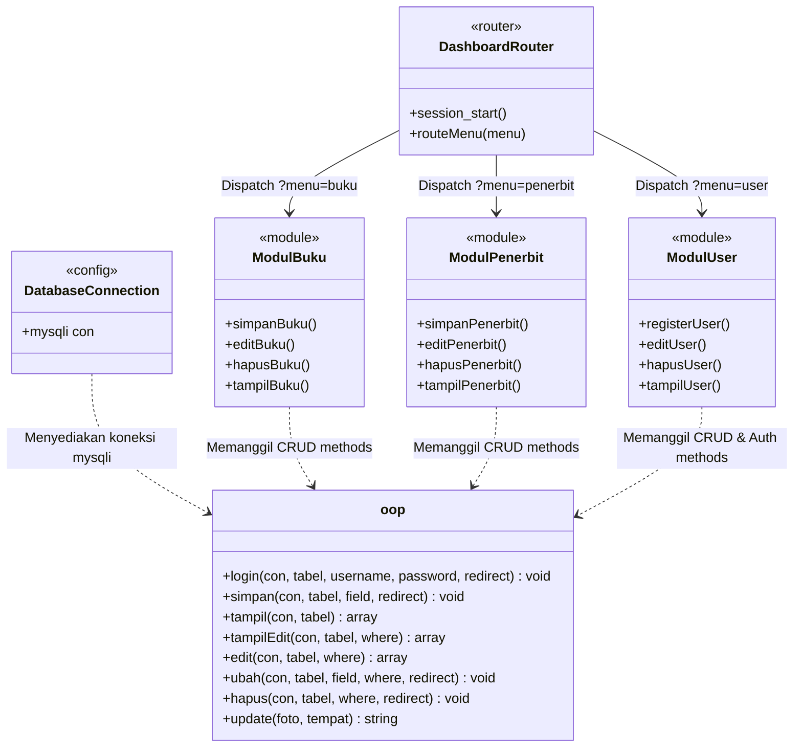
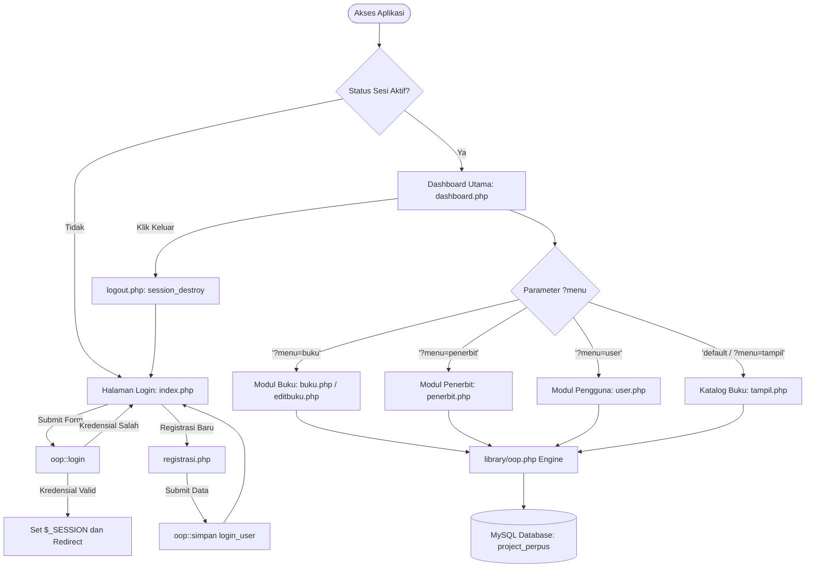
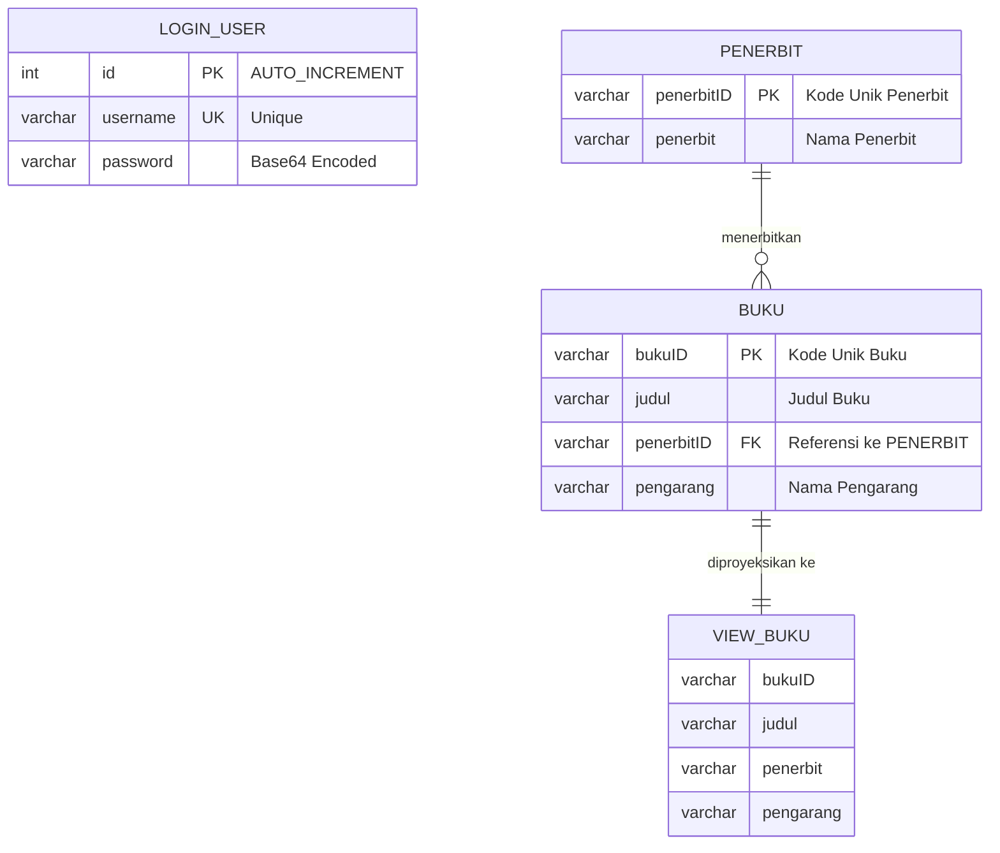

# 📚 Perpustakaan in OOP (Object-Oriented PHP)

[](https://www.php.net/)
[](library/oop.php)
[](database/schema.sql)
[](https://getbootstrap.com/)
[](LICENSE)

A lightweight **Object-Oriented PHP (Native)** Library Management System featuring a custom OOP CRUD abstraction engine, session-based authentication, and dynamic relational data rendering.

---

## 📖 Daftar Isi

1. [Gambaran Umum (Overview)](#-gambaran-umum-overview)
2. [Arsitektur Class OOP & Diagram](#-arsitektur-class-oop--diagram)
3. [Fitur-Fitur Utama](#-fitur-fitur-utama)
4. [Struktur Direktori Codebase](#-struktur-direktori-codebase)
5. [Skema Basis Data & Relasi](#-skema-basis-data--relasi)
6. [Panduan Instalasi & Menjalankan](#-panduan-instalasi--menjalankan)
   - [Opsi A: Menggunakan PHP Built-in Server](#opsi-a-menggunakan-php-built-in-server-cepat)
   - [Opsi B: Menggunakan Apache / XAMPP](#opsi-b-menggunakan-apache--xampp)
7. [Dokumentasi API Class `oop`](#-dokumentasi-api-class-oop)
8. [Catatan Keamanan & Rekomendasi Modernisasi](#-catatan-keamanan--rekomendasi-modernisasi)

---

## 🌟 Gambaran Umum (Overview)

**Perpustakaan in OOP** adalah sistem informasi manajemen perpustakaan berbasis web yang dibangun menggunakan **PHP Native** berparadigma **Object-Oriented Programming (OOP)**. 

Berbeda dengan skrip prosedural tradisional, proyek ini mengabstraksikan operasi basis data (Create, Read, Update, Delete) serta penanganan berkas dan autentikasi ke dalam satu reusable utility class (`class oop` pada `library/oop.php`). Pola ini memisahkan logika antarmuka dan alur kontrol modul dari perakitan kueri SQL mentah.

---

## 🏛 Arsitektur Class OOP & Diagram

Inti dari aplikasi ini adalah `class oop` yang bertindak sebagai **Data Access Helper / Query Builder Abstraction** bagi seluruh controller/view modul aplikasi (`buku`, `penerbit`, `user`, `login`).

### Class Diagram



### Alur Eksekusi Sistem (System Flowchart)



---

## ⚡ Fitur-Fitur Utama

1. **Autentikasi & Otorisasi Berbasis Sesi:**
   - Login petugas perpustakaan (`index.php`).
   - Registrasi user baru dengan validasi konfirmasi kata sandi (`registrasi.php`).
   - Proteksi akses halaman backend via verifikasi session global di `dashboard.php`.
   - Fitur logout aman (`logout.php`).
2. **Katalog Buku & Relasi Penerbit:**
   - Tampilan katalog terintegrasi memanfaatkan SQL View (`view_buku`).
   - Integrasi **DataTables jQuery** (pencarian instan, paginasi dinamis, dan sorting kolom).
3. **Manajemen Master Data Buku:**
   - Tambah buku dengan relasi dropdown dinamis ke tabel penerbit (`buku.php`).
   - Ubah detail judul, penerbit, dan pengarang (`editbuku.php`).
   - Hapus data dengan konfirmasi dialog interaktif.
4. **Manajemen Master Data Penerbit:**
   - CRUD data penerbit buku lengkap (`penerbit.php`).
5. **Manajemen Pengguna / Petugas:**
   - Pengelolaan akun petugas perpustakaan langsung dari panel dashboard (`user.php`).

---

## 📁 Struktur Direktori Codebase

```text
Perpustakaan-in-OOP/
├── config/
│   └── koneksi.php          # Konfigurasi koneksi MySQLi ke database
├── database/
│   └── schema.sql           # Skema DDL tabel, SQL view, dan seed data
├── library/
│   └── oop.php              # Core OOP Class (CRUD, Query Builder, Upload, Auth)
├── img/
│   └── bg.jpg               # Gambar latar belakang antarmuka login
├── logo/
│   ├── logowk.png           # Brand icon / logo instansi
│   └── h_s/                 # Aset icon interaktif
├── buku.php                 # Modul CRUD buku (Tambah, Hapus, Tampil)
├── dashboard.php            # Shell panel dashboard & router modul
├── editbuku.php             # Modul pembaruan spesifik data buku
├── index.php                # Antarmuka login utama
├── logout.php               # Handler pembersihan sesi (logout)
├── penerbit.php             # Modul CRUD master data penerbit
├── registrasi.php           # Antarmuka pendaftaran akun pengguna baru
├── tampil.php               # Tampilan tabel katalog buku relasional
├── user.php                 # Modul CRUD master pengguna sistem
├── .gitignore               # Konfigurasi pengabaian file Git
└── README.md                # Dokumentasi komprehensif sistem
```

---

## 🗄 Skema Basis Data & Relasi

Aplikasi menggunakan basis data bernama **`project_perpus`**. Skema DDL lengkap telah disediakan pada file [`database/schema.sql`](database/schema.sql).

### Entity Relationship Diagram (ERD)



### Ringkasan Entitas & View

| Nama Tabel / View | Tipe | Keterangan |
| :--- | :--- | :--- |
| `login_user` | Table | Menyimpan data akun petugas (id, username, password). |
| `penerbit` | Table | Master data penerbit buku (penerbitID, penerbit). |
| `buku` | Table | Master data buku perpustakaan berelasi ke penerbit. |
| `view_buku` | SQL View | Proyeksi relasi `LEFT JOIN` antara `buku` dan `penerbit` untuk penyajian katalog. |

---

## 🚀 Panduan Instalasi & Menjalankan

### Prasyarat Sistem
- **PHP**: Versi 7.4 atau 8.x
- **MySQL / MariaDB**: Versi 5.7+ atau MariaDB 10.3+
- **Ekstensi PHP**: `mysqli`, `session`, `json`

---

### Langkah 1: Persiapan Database

1. Buka MySQL client favorit lo (phpMyAdmin, MySQL Workbench, DBeaver, atau CLI).
2. Impor file [`database/schema.sql`](database/schema.sql):

```bash
# Melalui terminal MySQL CLI
mysql -u root -p < database/schema.sql
```

Atau buka phpMyAdmin, buat database `project_perpus`, lalu pilih menu **Import** dan pilih file `database/schema.sql`.

> **Akun Default Setelah Import:**
> - **Username:** `admin`
> - **Password:** `admin`

---

### Langkah 2: Konfigurasi Koneksi

Periksa file `config/koneksi.php` dan sesuaikan kredensial server lokal jika diperlukan:

```php
<?php 
    $con = mysqli_connect('localhost', 'root', '', 'project_perpus');
?>
```

---

### Opsi A: Menggunakan PHP Built-in Server (Cepat)

Lo dapat langsung menjalankan server tanpa instalasi web server berat:

```bash
# 1. Masuk ke root direktori repositori
cd /path/to/Perpustakaan-in-OOP

# 2. Jalankan PHP built-in web server
php -S localhost:8000
```

Buka peramban (browser) dan akses:
👉 **`http://localhost:8000`**

---

### Opsi B: Menggunakan Apache / XAMPP

1. Salin seluruh folder `Perpustakaan-in-OOP` ke direktori web root server lo:
   - **XAMPP (Windows):** `C:\xampp\htdocs\Perpustakaan-in-OOP`
   - **XAMPP (macOS):** `/Applications/XAMPP/xamppfiles/htdocs/Perpustakaan-in-OOP`
   - **LAMP (Linux):** `/var/www/html/Perpustakaan-in-OOP`
2. Jalankan service **Apache** dan **MySQL** melalui XAMPP Control Panel.
3. Akses via peramban:
   👉 **`http://localhost/Perpustakaan-in-OOP`**

---

## 🛠 Dokumentasi API Class `oop`

Objek diinisialisasi melalui:
```php
include "library/oop.php";
$go = new oop();
```

### Daftar Method

#### 1. `login($con, $tabel, $username, $password, $redirect)`
Memverifikasi kecocokan username dan password. Jika valid, membuka sesi `$_SESSION['user']` dan mengalihkan halaman ke `$redirect`.

#### 2. `simpan($con, $tabel, array $field, $redirect)`
Menyimpan data baru dengan secara otomatis menyusun kueri `INSERT INTO $tabel SET ...` dari array pasangan `key => value`.
```php
$field = [
    'bukuID' => 'B004',
    'judul' => 'Clean Code',
    'penerbitID' => 'P001',
    'pengarang' => 'Robert C. Martin'
];
$go->simpan($con, 'buku', $field, '?menu=buku');
```

#### 3. `tampil($con, $tabel)`
Mengambil seluruh rekaman data dari tabel atau view yang diberikan dan mengembalikan kumpulan baris dalam bentuk array asosiatif multidimensi.

#### 4. `edit($con, $tabel, $where)`
Mengambil satu rekaman baris data berdasarkan klausul kondisi `$where` (contoh: `"bukuID = 'B001'"`).

#### 5. `ubah($con, $tabel, array $field, $where, $redirect)`
Menjalankan kueri `UPDATE $tabel SET ... WHERE $where` secara dinamis dari array asosiatif `$field`.

#### 6. `hapus($con, $tabel, $where, $redirect)`
Menghapus data rekaman dari `$tabel` berdasarkan kondisi `$where`.

#### 7. `update($foto, $tempat)`
Helper fungsi penanganan upload berkas gambar ke folder tujuan lokal (`move_uploaded_file`).

---

## 🔒 Catatan Keamanan & Rekomendasi Modernisasi

Aplikasi ini didesain sebagai studi kasus arsitektur dasar pemrograman berorientasi objek dalam PHP native. Untuk penerapan pada level produksi (Production Environment), disarankan beberapa peningkatan keamanan berikut:

1. **Prepared Statements (SQL Injection Mitigation):**
   - Disarankan meng-upgrade eksekusi `mysqli_query` ke **PDO Prepared Statements** atau `mysqli::prepare` untuk mencegah injeksi SQL pada parameter input form.
2. **Password Hashing:**
   - Mengganti fungsi `base64_encode()` dengan algoritma standard industri seperti `password_hash($password, PASSWORD_BCRYPT)` dan `password_verify()`.
3. **Penyelarasan Tipe Data & Foreign Keys:**
   - Menggunakan tipe konsisten (misal `VARCHAR(20)`) antar foreign key `buku.penerbitID` dan primary key `penerbit.penerbitID`.

---

## 📄 Lisensi

Didistribusikan di bawah lisensi [MIT](LICENSE). Silakan gunakan dan kembangkan untuk tujuan edukasi dan referensi arsitektur kode.
